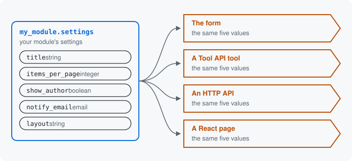

# What Data Surface does

You describe once what a thing on your site accepts: each value it
holds, its type, its label, its default and what it allows. From that
one description the module makes the form, a Tool API tool for AI
agents, the HTTP API and the React page. They all accept the same
values, because they all read the same description.



## The problem it removes

A Drupal settings form today describes its values in several places.
The defaults are in the config install file, the labels and widgets in
`buildForm()`, what is allowed in `validateForm()`, and the types in the
config schema. A REST resource or a tool for an AI agent on the same
settings describes them again. When one copy changes and another does not, the
tool accepts a value the form refuses.

## One description

Here are the settings of a module of your own, `my_module`, described
once. This is its resource class, `MySettingsResource`, in full:

```php
#[Resource('my_module.settings', storage: MySettingsStorage::class)]
#[Operation('configure',
  label: new TranslatableMarkup('Configure my module'),
  permission: 'administer my_module',
)]
final class MySettingsResource implements ResourceInterface {

  public static function defineInputs(BlueprintInterface $inputs): void {
    $inputs->add('title', 'string', t('Title'), default: 'Latest content')
      ->setRequired(TRUE)
      ->addConstraint('Length', ['max' => 64]);

    $inputs->add('items_per_page', 'integer', t('Items per page'), default: 10)
      ->setRequired(TRUE)
      ->addConstraint('Range', ['min' => 1, 'max' => 50]);

    $inputs->add('show_author', 'boolean', t('Show the author'), default: TRUE);

    $inputs->add('notify_email', 'email', t('Email for notices'), default: 'admin@example.com');

    $inputs->add('layout', 'string', t('Layout'), default: 'list')
      ->setRequired(TRUE)
      ->addConstraint('LabeledChoice', [
        'choices' => [
          'list' => t('List'),
          'grid' => t('Grid'),
        ],
      ]);
  }

}
```

Where each class lives: [Namespaces](../concepts.md#namespaces).

Each `add()` names one value: its name, its type, its label and its
default. The calls chained after it say what the value allows. The two
attributes above the class name the settings, `my_module.settings`, the
class that saves them, and the way of asking for them with its
permission; later pages explain each.

There is no form class, no validation handler and no tool class. For a
config object your module owns, a Drush command generates the config
schema and the install file from the class and fails when they drift
from it, so they repeat the class's facts without being a second
description. The module makes the rest from this class:

| What you get | From the same five values |
| --- | --- |
| A form | a text field, a number field, a checkbox, an email field and a select |
| A Tool API tool | `data_surface:my_module.settings:configure`, which an AI agent calls |
| An HTTP API | `PATCH /surface-api/my_module.settings`, with a JSON Schema of the values |
| A React page | a form drawn in the browser from that JSON Schema |

The form is served on a route: a routing entry that names the class and
the way of asking for it ([Operations](07-operations.md) shows one).

The tool, the HTTP API and the React page each come from a submodule
you install when you want it. A later page lists them
([Doors](11-doors.md)).

A value the description does not allow is refused at every one of them,
with the same message, because each one checks against the same
description. The module calls that description, once it is complete, a
data surface; [Sealed](15-sealed.md) shows how it is made.

## Three words to come

The next pages give each part of this a name:

- The thing described, here your module's settings, is a
  **resource** ([Resources](02-resources.md)).
- Each value it holds, such as `items_per_page`, is a **key**
  ([Keys](03-keys.md)).
- Each place that asks for the values, such as the form or the tool, is
  a **door** ([Doors](11-doors.md)).

Next: [Resources](02-resources.md)

Build it: [Your first resource](../first-resource.md)

See it in the examples: [Examples](../examples/index.md)
