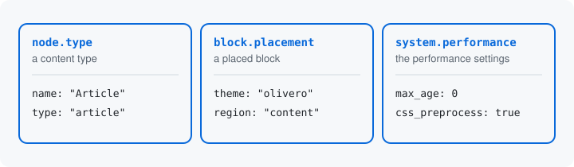

# Resources

A resource is a thing your site keeps values for, that can be asked for
on its own. A content type is one: each has a name, a machine name and
its settings, and you can add, edit or delete one. A placed block is
another, with its theme, its region and its plugin. Your own module's
settings are a third: one config object you change.



## On its own

"On its own" means a caller can name the resource and ask to change it,
with nothing around it. A content type, a placed block and a
module's settings each pass that test.

A block plugin's settings do not. They are values too, but nobody asks
for them apart from the placed block that holds them. A later page
covers values like these, held by something else
([Structures](09-structures.md)).

## A resource is a class

You make something a resource with a class that carries the
`#[Resource]` attribute, in your module's `src/Resource/` directory.
The attribute's first argument is the resource's id. The settings of
[the previous page](01-what-it-does.md) are the class
`MySettingsResource`, and these are its attributes:

```php
#[Resource('my_module.settings', storage: MySettingsStorage::class)]
#[Operation('configure',
  label: new TranslatableMarkup('Configure my module'),
  permission: 'administer my_module',
)]
```

Where each class lives: [Namespaces](../concepts.md#namespaces).

The second attribute, `#[Operation]`, and the `storage:` argument are
the ideas of [Operations](07-operations.md) and [Storage](08-storage.md).

The module ships resources for things core already has. The
`data_surface_demo_node_type` submodule's `NodeTypeResource` makes a
content type the resource `node.type`. The `data_surface_block`
submodule's `BlockPlacementResource` makes core's placed block config
entity, `block`, the resource `block.placement`, and ships the routes
that serve it. Later pages show parts of both.

The module finds the class the way core finds a hook class in
`src/Hook`, so nothing is registered in a services file. It never
constructs the class: everything the class says is in static methods,
so the module reads it without building anything, ahead of any request.
The next page starts on those methods.

## A resource describes, it does not store

The class says what the values are and what they allow. The values
stay where Drupal already keeps them: the node type config entity, the
block config entity `block.block.<id>`, the `my_module.settings` config
object. A later page shows how a resource names that place
([Storage](08-storage.md)). Because the class only describes, you can
make a resource of something core already has without changing how
core saves it.

## What the module sees

`drush surface:catalog --format=markdown` lists every resource the
module finds on a site. Its entry for the placed block starts:

```
## block.placement

`Drupal\data_surface_block\Resource\BlockPlacementResource`, in `data_surface_block`.

- Kind: resource
```

`Kind` says what sort of entry it is: a resource, or a group of values
held by something else, which [Structures](09-structures.md) covers.

Next: [Keys](03-keys.md)

Build it: [Your first resource, step 4: the resource](../first-resource.md#4-the-resource)

See it in the examples: [Examples](../examples/index.md)
