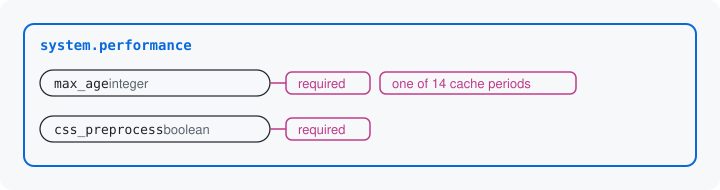

# Rules on a key

A rule says what values a key allows. A key can be required, a text can
have a maximum length, a number can have a range, and a value can be
held to a list of choices. Rules are Drupal's validation constraints:
the same `Length`, `Range` and `Choice` that entity fields and config
schema already use.



## Adding rules

`add()` returns core's `DataDefinition`, so a rule is a call on it. The
performance settings' keys, with their rules:

```php
$periods = [0 => '<no caching>', 60 => '1 min', /* ... */ 86400 => '1 day'];
// The class builds these 14 labels with core's date formatter, as core's form does.

$inputs->add('max_age', 'integer', t('Browser and proxy cache maximum age'), default: 0)
  ->setRequired(TRUE)
  ->addConstraint('LabeledChoice', ['labels' => $periods]);

$inputs->add('css_preprocess', 'boolean', t('Aggregate CSS files'), default: TRUE)
  ->setRequired(TRUE);
// js_preprocess is declared as css_preprocess is.
```

- `setRequired(TRUE)`: the key must hold a value. `FALSE`, `0` and an
  empty list count as a value; only nothing and the empty string do
  not.
- `addConstraint('LabeledChoice', ['labels' => ...])`: one of a list of
  values, each with a label. `labels` maps each allowed value to its
  label. The module's `LabeledChoice` is core's `Choice` with labels
  added. [Your first resource](../first-resource.md) writes the same
  map under `choices`, the form for text values; `labels` is the form
  for integer values.
- `addConstraint('Length', ...)` and `addConstraint('Range', ...)`: the
  most characters a text may have, and the lowest and highest number. A
  placed block's title, for instance, is at most 255 characters.

Any other constraint registered with Drupal works as well. A rule is
written once, on the key, and nowhere else.

## What the form and the tool do with it

The form reads the rules to draw the fields: `max_age` becomes a select
of the 14 periods, and a required key is marked required.

The JSON Schema states the same rules, for a tool or a client to read
before it sends anything (trimmed to three of the 14 periods):

```json
"max_age": {
  "title": "Browser and proxy cache maximum age",
  "type": "integer",
  "oneOf": [
    {"const": 0, "title": "<no caching>"},
    {"const": 60, "title": "1 min"},
    {"const": 86400, "title": "1 day"}
  ],
  "default": 0
},
"required": ["max_age", "css_preprocess", "js_preprocess"]
```

A value that breaks a rule is refused at its key, in the rule's words.
Send `max_age` as `null`, and the tool refuses it with this object:

```json
{
  "path": "/max_age",
  "code": "required",
  "message": "Browser and proxy cache maximum age is required."
}
```

The form says "Browser and proxy cache maximum age is required." at the
field. Send `120`, which is not one of the periods, and the message
lists the allowed values instead: "The value you selected is not a
valid choice. Choose 0 (<no caching>), 60 (1 min), ..."

Each place that asks for the values wraps a refusal in its own
envelope: the tool's `violations` list, the HTTP API's `errors` list,
the form's message at the field. The path, the code and the message
inside are the same everywhere, and later pages show only that inner
object.

Next: [Rules between keys](05-rules-between-keys.md)

Build it: [Declaring a resource or structure: required](../declaring-a-resource.md#required), then [Options and resolvers](../options.md) for lists of choices

See it in the examples: [Examples](../examples/index.md)
