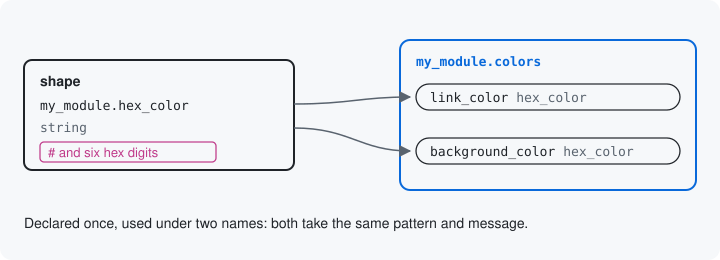

# Shapes

A shape is one value declared once, as a class: its type, its label,
its description, what it allows and an example. A resource or a
structure then uses it under as many names as it needs. The value reads
the same everywhere it is used, and a module that tightens the shape
tightens it everywhere at once ([Other modules](13-other-modules.md)
shows how one module tightens another's).



## Declaring one

Your module keeps two colors, one for links and one for the background,
in a second config object, `my_module.colors`. Both are written the
same way: `#` and six hexadecimal digits. The shape says so once. It is
a class in your module's `src/Shape/` directory, with `#[Shape]` and
its id, and its static `define()` returns core's `DataDefinition`:

```php
#[Shape('my_module.hex_color')]
final class HexColor implements ShapeInterface {

  public static function define(): DataDefinition {
    $color = DataDefinition::create('string')
      ->setLabel(t('Color'))
      ->setDescription(t('A # and six hexadecimal digits, such as #0969DA.'))
      ->addConstraint('Regex', [
        'pattern' => '/^#[0-9A-Fa-f]{6}$/D',
        'message' => t('Write the color as # and six hexadecimal digits, such as #0969DA.'),
      ]);
    DefinitionMetadata::setExamples($color, ['#0969DA']);
    return $color;
  }

}
```

`Regex` is Drupal's validation constraint for a pattern, and its
`message` is what a caller reads when a value does not match.
`DefinitionMetadata::setExamples()` adds an example of a good value. A
shape has no default and is never required: each place that uses it
decides those.

## Using it twice

The colors' class names the shape where a type would go, once for each
value, and gives each its own label and default. This is
`MyColorsResource` in full; its two attributes work as the settings'
do on [Resources](02-resources.md):

```php
#[Resource('my_module.colors', storage: MyColorsStorage::class)]
#[Operation('configure',
  label: new TranslatableMarkup('Configure my module colors'),
  permission: 'administer my_module',
)]
final class MyColorsResource implements ResourceInterface {

  public static function defineInputs(BlueprintInterface $inputs): void {
    $inputs->add('link_color', HexColor::class, t('Link color'), default: '#0969DA')
      ->setRequired(TRUE);

    $inputs->add('background_color', HexColor::class, t('Background color'), default: '#FFFFFF')
      ->setRequired(TRUE);
  }

}
```

Each `add()` starts from a copy of the shape, so `link_color` and
`background_color` take the same pattern and the same message. A use
may make the shape stricter, as `setRequired(TRUE)` does here, and
never looser: a use that would allow more than the shape is refused
with a message that names both.

## What you get

The JSON Schema the module writes for the colors points both values at
one definition, under `$defs`, by the shape's id (trimmed to the
pointer, the label and the default):

```json
"link_color": {"$ref": "#/$defs/my_module.hex_color", "title": "Link color", "default": "#0969DA"},
"background_color": {"$ref": "#/$defs/my_module.hex_color", "title": "Background color", "default": "#FFFFFF"}
```

The shape itself is written once:

```json
"my_module.hex_color": {
  "title": "my_module.hex_color",
  "description": "A # and six hexadecimal digits, such as #0969DA.",
  "type": ["string", "null"],
  "pattern": "^#[0-9A-Fa-f]{6}$",
  "examples": ["#0969DA"],
  "x-surface": {"patternMessage": "Write the color as # and six hexadecimal digits, such as #0969DA."}
}
```

Its `type` allows `null` because whether a value may be empty is
decided where the shape is used, here by `setRequired(TRUE)`. Send
`blue` and `#fff`, and the tool refuses both with the shape's message:

```json
"violations": [
  {
    "path": "/link_color",
    "code": "regex_failed",
    "message": "Write the color as # and six hexadecimal digits, such as #0969DA."
  },
  {
    "path": "/background_color",
    "code": "regex_failed",
    "message": "Write the color as # and six hexadecimal digits, such as #0969DA."
  }
]
```

Next: [Keys](05-keys.md)

Build it: [Named shapes](../declaring-a-resource.md#named-shapes)

See it in the examples: [Examples](../examples/index.md)
