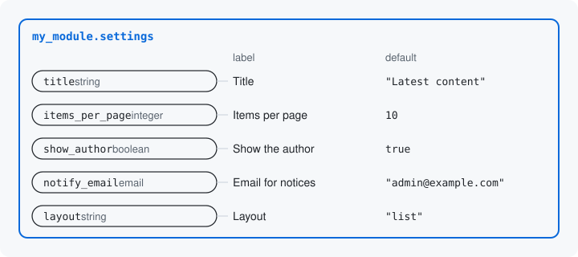

# Keys

A key is one value a resource or a structure holds. Each key has a
name, a type, a label and, where it needs one, a default. You declare a key by adding
it with `add()` in the resource class's static `defineInputs()` method.



## Declaring keys

Your module's settings have five keys, one of each basic type. This is
`MySettingsResource`'s `defineInputs()` method, which declares them:

```php
public static function defineInputs(BlueprintInterface $inputs): void {
  $inputs->add('title', 'string', t('Title'), default: 'Latest content')
    ->setRequired(TRUE)
    ->addConstraint('Length', ['max' => 64]);

  $inputs->add('items_per_page', 'integer', t('Items per page'), default: 10)
    ->setRequired(TRUE)
    ->addConstraint('Range', ['min' => 1, 'max' => 50]);

  $inputs->add('show_author', 'boolean', t('Show the author'), default: TRUE);

  $inputs->add('notify_email', 'email', t('Email for notices'), default: 'admin@example.com');

  $inputs->add('layout', 'string', t('Layout'), default: 'list')
    ->setRequired(TRUE)
    ->addConstraint('LabeledChoice', [
      'choices' => [
        'list' => t('List'),
        'grid' => t('Grid'),
      ],
    ]);
}
```

Where each class lives: [Namespaces](../concepts.md#namespaces).

`defineInputs()` receives `$inputs`, a `BlueprintInterface`: the object
the class adds its keys to. The method and the object are named for
inputs, the values a caller sends; each input is a key. The calls
chained after an `add()`, such as `setRequired()` and `addConstraint()`,
say what the key allows: the next page's idea.

## The four parts of a key

`add()` takes the key's name, its type, its label and its default:

- **Name**: what the value is sent and read under, `items_per_page`.
- **Type**: a Drupal typed data type: `string`, `integer`, `boolean`
  and `email` here, and also `float` or `uri`; or a shape's class, as
  `HexColor::class` on [Shapes](04-shapes.md). A value sent as the text
  `"20"` to the `integer` key `items_per_page` is accepted as the
  integer `20`.
- **Label**: the form element's title, the tool's property title and
  the JSON Schema's `title`, one text for all three. Write it with
  `t()`.
- **Default**: what the key starts from when nothing is saved for it.

`add()` returns core's own `DataDefinition`, so anything more about the
key is core's API: `setDescription()` for the text under the field, and
the methods the next page uses for what a key allows.

`defineInputs()` is static and runs with no values, so it cannot read
what another key holds. A key whose allowed values depend on another
key is a later page's idea ([Rules between keys](07-rules-between-keys.md)).

## What you get

The type picks the form element: a text field for `title`, a number
field for `items_per_page`, a checkbox for `show_author` and an email
field for `notify_email`. The JSON Schema the module writes for a tool
or an HTTP client states the same keys, with the same titles, types
and defaults (trimmed to two keys and those three facts):

```json
"title": {"title": "Title", "type": "string", "default": "Latest content"},
"items_per_page": {"title": "Items per page", "type": "integer", "default": 10}
```

Next: [Rules on a key](06-rules-on-a-key.md)

Build it: [Declaring a resource or structure: the class](../declaring-a-resource.md#the-class)

See it in the examples: [Examples](../examples/index.md)
