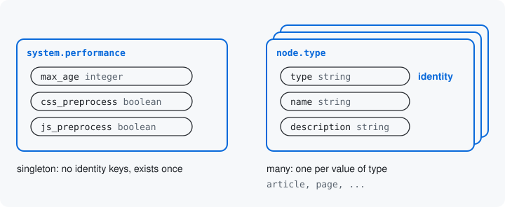

# Which one: identity

Some resources exist once on a site. Others exist many times, and a
request has to say which one it is about. The keys that say which one
are the resource's **identity**.



## Once, or many times

The performance settings exist once. `system.performance` is one
config object, so there is nothing to choose between. A resource with
no identity keys is a **singleton**.

A content type exists many times: Article, Basic page, and any other a
site adds. Each has a machine name, `article` or `page`, and the
machine name says which content type a request is about. So `type`, the
machine name, is the content type resource's identity key.

A resource names its identity keys on its `#[Resource]` attribute:

```php
#[Resource('system.performance',
  // ...
)]
final class PerformanceResource implements ResourceInterface {
  // defineInputs() declares max_age, css_preprocess and js_preprocess.
}

#[Resource('node.type',
  identity: ['type'],
  // ...
)]
final class NodeTypeResource implements ResourceInterface {
  // defineInputs() declares type, name, description and the rest.
}
```

Where each class lives: [Namespaces](../concepts.md#namespaces).

`type` is still a key, declared in `defineInputs()` with a type, a label
and its rules. The attribute only says it is the key that tells content
types apart. It sits on the attribute, not among the keys, because it is
part of the resource's address: anything that asks for one content type
must name it first.

A resource may have more than one identity key. The
`data_surface_entity` submodule makes one resource per bundle of a
content entity type, such as `entity.content:node.page` for the Basic
page content type, and each names three: `entity_type`, `bundle` and
`id`.

## What it changes

The address the module makes for a resource carries its identity keys,
each under its own name. These are the HTTP paths it makes for editing
each of the two:

```text
PATCH /surface-api/system.performance
PATCH /surface-api/node.type/{type}
```

The singleton's path names nothing more, since there is only one. The
content type's path names `type`. The tool an AI agent calls to edit a
content type takes `type` as an input of its own. The keys to change go
in the tool's input field `values`, beside it.

Identity also decides what may change. When a request edits the
`article` content type, `type` is already known, so it is locked to
`article`: the edit cannot rename the machine name. When a request adds
a content type, `type` is not known yet, so it is open and the caller
chooses it. [The next page](07-operations.md) shows how each way of
asking says what it already knows.

Next: [Operations](07-operations.md)

Build it: [Operations and identity](../declaring-a-resource.md#operations-and-identity)

See it in the examples: [Examples](../examples/index.md)
