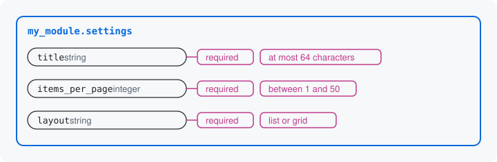

# Rules on a key

A rule says what values a key allows. A key can be required, a text can
have a maximum length, a number can have a range, and a value can be
held to a list of choices. Rules are Drupal's validation constraints:
the same `Length`, `Range` and `Choice` that entity fields and config
schema already use.



## Adding rules

`add()` returns core's `DataDefinition`, so a rule is a call chained on
it. The three keys of your module's settings that carry rules:

```php
$inputs->add('title', 'string', t('Title'), default: 'Latest content')
  ->setRequired(TRUE)
  ->addConstraint('Length', ['max' => 64]);

$inputs->add('items_per_page', 'integer', t('Items per page'), default: 10)
  ->setRequired(TRUE)
  ->addConstraint('Range', ['min' => 1, 'max' => 50]);

$inputs->add('layout', 'string', t('Layout'), default: 'list')
  ->setRequired(TRUE)
  ->addConstraint('LabeledChoice', [
    'choices' => [
      'list' => t('List'),
      'grid' => t('Grid'),
    ],
  ]);
```

- `setRequired(TRUE)`: the key must hold a value. `FALSE`, `0` and an
  empty list count as a value; only nothing and the empty string do
  not. `show_author` and `notify_email` are not required, so a caller
  may clear them.
- `addConstraint('Length', ['max' => 64])`: the most characters a text
  may have.
- `addConstraint('Range', ['min' => 1, 'max' => 50])`: the lowest and
  highest number.
- `addConstraint('LabeledChoice', ['choices' => ...])`: one of a list
  of values, each with a label. `choices` maps each allowed value to
  its label. The module's `LabeledChoice` is core's `Choice` with
  labels added.

Any other constraint registered with Drupal works as well. A rule is
written once, on the key, and nowhere else.

## What the form and the tool do with it

The form reads the rules to draw the fields: `layout` becomes a select
of List and Grid, `items_per_page` a number field from 1 to 50, and a
required key is marked required.

The JSON Schema states the same rules, for a tool or a client to read
before it sends anything (trimmed to two keys):

```json
"items_per_page": {
  "title": "Items per page",
  "type": "integer",
  "minimum": 1,
  "maximum": 50,
  "default": 10
},
"layout": {
  "title": "Layout",
  "type": "string",
  "oneOf": [
    {"const": "list", "title": "List"},
    {"const": "grid", "title": "Grid"}
  ],
  "default": "list"
},
"required": ["title", "items_per_page", "layout"]
```

A value that breaks a rule is refused at its key, in the rule's words.
Send `title` as `null`, and the tool refuses it with this object:

```json
{
  "path": "/title",
  "code": "required",
  "message": "Title is required."
}
```

The form says "Title is required." at the field. Send `layout` as
`table`, which is not one of the choices, and the message lists the
allowed values instead: "The value you selected is not a valid choice.
Choose list (List) or grid (Grid)."

Each place that asks for the values wraps a refusal in its own
envelope: the tool's `violations` list, the HTTP API's `errors` list,
the form's message at the field. The path, the code and the message
inside are the same everywhere, and later pages show only that inner
object.

Next: [Rules between keys](07-rules-between-keys.md)

Build it: [Declaring a resource or structure: required](../declaring-a-resource.md#required), then [Options and resolvers](../options.md) for lists of choices

See it in the examples: [Examples](../examples/index.md)
