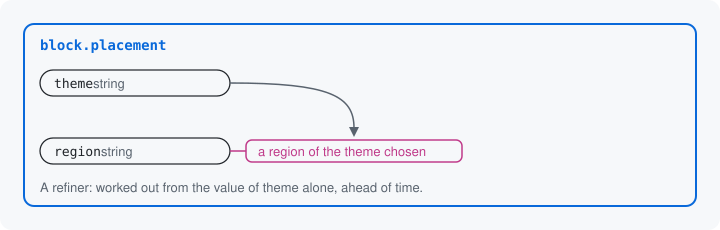

# Rules between keys

What one key allows can depend on another key's value. A placed
block's `region` must be a region of its `theme`: `sidebar` is a region
of Olivero, `sidebar_first` is not. Some of these answers are known
ahead of time from the values alone. Others need the site, and are
worked out when the request comes in.



## A refiner

A refiner is a static method with `#[RefinesInput]`. It takes the
key's definition, and one parameter for each key it watches, matched
by name. It returns the key narrowed. The placed block's region, from
`BlockPlacementResource`:

```php
#[RefinesInput('region')]
public static function regionsOfTheme(DataDefinitionInterface $region, string $theme): DataDefinitionInterface {
  return $region->addConstraint('DataSurfaceThemeRegion', ['theme' => $theme]);
}
```

Where each class lives: [Namespaces](../concepts.md#namespaces).

`DataSurfaceThemeRegion` is a constraint this module ships: it allows
only the regions of the theme it names. `defineInputs()` declares
`region` as a region of any installed theme. Once `theme` holds a
value, the refiner narrows `region` to that theme's regions. A refiner
may narrow what a key allows; it may never widen it.

The same theme always gives the same regions, so the module runs this
refiner ahead of time, for every theme, and writes each answer into the
JSON Schema: `region` is marked `"dependsOn": ["theme"]`, and each
theme gets an `if` and a `then` (trimmed to Olivero, and to three of
its regions):

```json
{"if": {"properties": {"theme": {"const": "olivero"}}, "required": ["theme"]},
 "then": {"properties": {"region": {"oneOf": [{"const": "header", "title": "Header"}, {"const": "content", "title": "Content"}, {"const": "sidebar", "title": "Sidebar"}]}}}}
```

Send `sidebar_first` with the theme `olivero`, and the tool refuses it
with the same inner object [the previous page](06-rules-on-a-key.md)
showed. The message's last sentence names the condition that made the
rule apply:

```json
{
  "path": "/region",
  "code": "theme_region",
  "message": "The olivero theme has no region named sidebar_first. This applies when Theme is olivero (Olivero)."
}
```

## A declared rule

A declared rule is a static refiner written as data. When a rule is a
condition and an effect, you declare it in `defineInputs()` with
`narrow()` and write no method. A sketch, with made-up keys:

```php
$inputs->narrow('end_date')
  ->when(Condition::present('start_date'))
  ->require();
```

Where each class lives: [Namespaces](../concepts.md#namespaces).

`when()` takes a condition on other keys' values, such as `present()`
or `equals()`, and the last call is the effect. Because the rule is
data, the JSON Schema states it as written, with nothing run. A
declared rule only tightens: one that would allow more than the key
declares is refused the first time anything asks for the resource, so
no form or tool ever offers the wider value.
[Declaring a rule](../refinement.md#declaring-a-rule) lists every
condition and effect.

## When the answer needs the site

A rule that needs the site or the account, such as which text formats
an account may use, is a refiner that declares `runtime: TRUE`. It is
worked out when the request comes in, with that request's values, and
the JSON Schema marks the key `live`
([Static and runtime refiners](../refinement.md#static-and-runtime-refiners)).

Next: [Which one: identity](08-identity.md)

Build it: [Declaring a rule](../refinement.md#declaring-a-rule), then [Static and runtime refiners](../refinement.md#static-and-runtime-refiners)

See it in the examples: [Examples](../examples/index.md)
