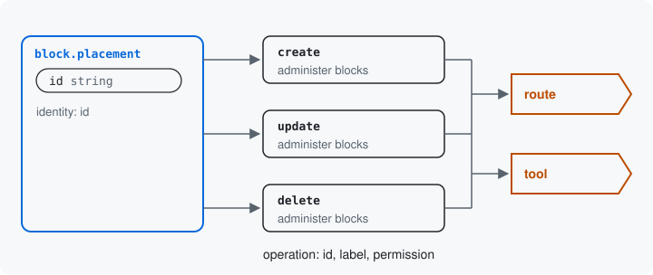

# Operations

An operation is one way of asking for a resource: place a block, edit a
placed block, remove one. Each operation has an id, a label and the
permission an account needs to ask it. The module makes routes and
tools from operations, so a resource is reachable only through the
operations it declares.



## Declaring them

The placed block, `block.placement`, declares three operations. An
operation is an `#[Operation]` attribute with an id, a label, a
description and a permission, in one of two places. These are
`BlockPlacementResource`'s operations in full. Above the class, beside
`#[Resource]`:

```php
#[Resource('block.placement',
  identity: ['id'],
  storage: BlockPlacementStorage::class,
)]
#[Operation('create',
  label: new TranslatableMarkup('Place a block'),
  description: new TranslatableMarkup('Places a block under a machine name the caller chooses, in a region of a theme, with the settings its plugin takes; a machine name already in use is refused.'),
  permission: self::PERMISSION,
  creates: TRUE,
  idempotent: TRUE,
)]
```

Inside the class, the permission they share and the two methods:

```php
  public const PERMISSION = 'administer blocks';

  #[Operation('update',
    label: new TranslatableMarkup('Edit a placed block'),
    description: new TranslatableMarkup('Changes a placed block, named by its machine name: its label, region, weight, status, plugin settings and visibility. Its theme stays as it is.'),
    permission: self::PERMISSION,
  )]
  public static function update(BlockInterface $id): OperationContext {
    return (new OperationContext(known: ['id' => (string) $id->id()]))
      ->withConstraint('theme', 'Choice', ['choices' => [$id->getTheme()]]);
  }

  #[Operation('delete',
    label: new TranslatableMarkup('Remove a placed block'),
    description: new TranslatableMarkup('Removes a placed block, named by its machine name, from its region.'),
    permission: self::PERMISSION,
    destructive: TRUE,
    deletes: TRUE,
  )]
  public static function delete(BlockInterface $id): OperationContext {
    return new OperationContext(known: ['id' => (string) $id->id()]);
  }
```

- **On the class**, when asking needs nothing more. `create` knows
  nothing yet: the caller chooses the machine name. Your module's
  settings declare their one operation this way, with the id
  `configure` ([Resources](02-resources.md) shows it). That id is the
  usual one for a settings operation, not a reserved word.
- **On a static method**, when the operation knows something. `update`
  and `delete` each act on one block, so each knows that block's
  machine name.

The method's parameters are what the operation needs, and a route or a
tool supplies them by name. The parameter `$id` is named after the
identity key. The update route declares `{id}` as `entity:block` in
its options, so Drupal's param converter upcasts it and the method
receives the loaded block entity. The method returns an
`OperationContext`: the object that says which operation is asked and
what it already knows, here the `id`. `update()` also holds `theme` to
the one the block is in, with `withConstraint()`, so an edit cannot
move a block to another theme;
[Operations](../resources.md#operations-create-update-and-the-rest) has
the rest of what a method can add. The `storage:` argument is the next
page's idea.

A route names the resource class and the operation:

```yaml
surface_examples_block.update:
  path: '/admin/structure/block/surface/{id}'
  defaults:
    _form: 'Drupal\surface\Form\SurfaceOperationForm'
    _title: 'Edit a placed block (resource)'
    _surface_resource: 'Drupal\surface_examples_block\Resource\BlockPlacementResource'
    _surface_operation: 'update'
    _surface_cosmetics: 'surface_examples_block.form_cosmetics'
  options:
    parameters:
      id:
        type: 'entity:block'
```

`_surface_cosmetics` names a service that adds what only this page
needs, such as a message or a redirect, and never changes what the form
accepts. That route is a working form with no form
class of its own. The same
operation is also the tool `surface:block.placement:update`.

## What is known is locked

An identity key the operation knows is locked to that value. In the
JSON Schema the module writes for editing Olivero's main content
block, `olivero_content`, the machine name says so (trimmed):

```json
"id": {"title": "Machine name", "type": "string", "default": "olivero_content", "readOnly": true, "const": "olivero_content"}
```

For `create`, the same key has no `readOnly` and no `const`: the caller
types it.

## The permission

Every route and tool made from an operation checks that operation's
permission, here `administer blocks`, the block layout's own. An
operation may also say how a call behaves: `creates: TRUE` for one that
adds a thing, and `deletes: TRUE` for one that removes it. A create is
not idempotent unless it says so; this one is, with `idempotent: TRUE`,
because the caller names the block, so a second identical call is
refused for the machine name the first one took and changes nothing.
`deletes: TRUE` makes the call take no values, only the parameters that
name the thing; the module requires `destructive: TRUE` beside it,
which tells a client to ask before it calls. A later page shows how
[access](15-access.md) decides, beyond the permission, which keys an
account may change.

Next: [Storage](10-storage.md)

Build it: [Operations: create, update, and the rest](../resources.md#operations-create-update-and-the-rest)

See it in the examples: [Examples](../examples/index.md)
