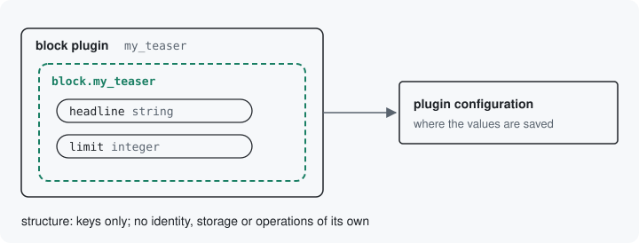

# Structures

A structure is a group of keys with no identity, storage or operations
of its own. Something else holds its values and saves them. A block
plugin's settings are a structure: the block plugin's configuration
holds them, and a placed block saves that configuration.



## Declaring one

Take a teaser block you would write in your own module, with a headline
and a number of items. Its settings are a structure. A structure declares its keys and rules as a
resource does, in `defineInputs()`, with `#[Structure]` in place of
`#[Resource]`:

```php
#[Structure('block.my_teaser')]
final class TeaserBlockStructure implements StructureInterface {

  public static function defineInputs(BlueprintInterface $inputs): void {
    $inputs->add('headline', 'string', t('Headline'), default: 'Featured content')
      ->setRequired(TRUE)
      ->addConstraint('Length', ['max' => 50]);
    $inputs->add('limit', 'integer', t('Number of items'), default: 10)
      ->setRequired(TRUE)
      ->addConstraint('Range', ['min' => 1, 'max' => 50]);
  }

}
```

`block.my_teaser` is the structure's id, a machine name you choose;
`block.` and the plugin id keep it beside the plugin it belongs to.

With this module, the block plugin names the structure and extends the
module's `DataSurfaceBlockBase` instead of `BlockBase`:

```php
#[Block(id: 'my_teaser', admin_label: new TranslatableMarkup('Teaser'))]
#[UsesStructure(TeaserBlockStructure::class)]
final class TeaserBlock extends DataSurfaceBlockBase {
  // build() is unchanged.
}
```

Where each class lives: [Namespaces](../concepts.md#namespaces).

The block loses its `defaultConfiguration()`, `blockForm()`,
`blockValidate()` and `blockSubmit()`. Its configuration form is made
from the structure: a text field with a maximum length of 50 for the
headline, and a number field bounded at 1 and 50 for the limit, each
starting from its key's default.

A small plugin can be its own structure: `#[UsesStructure]` with no
argument, and `StructureInterface` and `defineInputs()` on the block
class itself. A separate structure class earns its place when more
than one plugin shares the settings.

## What it does not have

A structure names no identity, no storage and no operations, so the
module makes no route, tool or HTTP path for it. The catalog shows a
placed block's visibility condition, another structure, that way
(`drush surface:catalog --resource=block.placement.condition
--format=markdown`, trimmed):

```
# block.placement.condition

- Kind: structure
- Identity: none
- Storage: none
```

What holds the structure supplies the rest, its storage included. For
a block plugin alone, that is the plugin: its configuration is where
the values go, saved through the module's `PluginConfigurationStorage`,
the storage for a plugin's configuration, and the block's own form is
where they are asked for. When the plugin is
chosen on a placed block, the placed block holds the same structure
under its `settings` key, and its operations, permission and storage
apply. [The next page](10-putting-together.md) shows how.

Next: [Resources made of structures](10-putting-together.md)

Build it: [On a plugin](../declaring-a-resource.md#on-a-plugin)

See it in the examples: [Examples](../examples/index.md)
