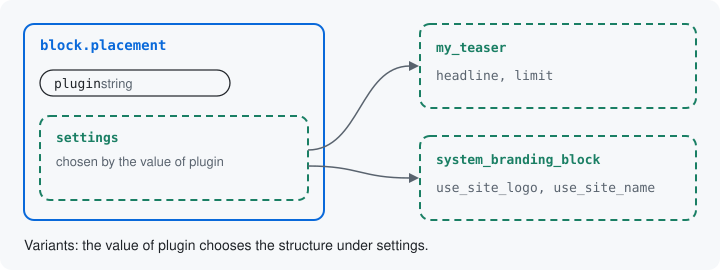

# Resources made of structures

A resource or structure can hold other structures at its keys. This
page shows the two ways a Drupal developer meets first, attach and
variants, and shows variants on the placed block.



## Attach and variants

- **Attach**: one structure under one key, its keys saved as a group
  under that key, as a node's `body` field is a structure of `value`,
  `summary` and `format` at the key `body`
  ([Children](../resources.md#children)).
- **Variants**: one of several structures under one key, chosen by
  another key's value, as a placed block's `settings` are chosen by its
  `plugin` ([Variants](../resources.md#variants)).

The module has four more ways: a collection (a list), a mixin, a port
and keys from the site. [Which way to compose](../resources.md#which-way-to-compose)
puts all six side by side, with the question each one answers.

## Variants: a placed block's settings

A placed block shows one block plugin, and each plugin has its own
settings. The teaser block of the previous page takes a `headline` and
a `limit`; the site branding block takes `use_site_logo`, `use_site_name` and
`use_site_slogan`. So the placed block's `settings` key cannot hold one
fixed structure. Its `plugin` key chooses which one. These are the two
keys in `BlockPlacementResource`'s `defineInputs()`, in full:

```php
$inputs->add('plugin', 'string', t('Block'))
  ->setDescription(t('What the block shows: a block plugin the block layout offers. A block that reads a context, such as the node of the page, is not offered yet.'))
  ->setRequired(TRUE);

$inputs->attachVariants('settings', by: 'plugin', from: BlockPluginStructures::class)
  ->setLabel(t('Settings'))
  ->setDescription(t('The settings of the block chosen, as its plugin declares them.'));
```

`BlockPluginStructures` lists one variant per block plugin the block
layout offers. A plugin that names its structure with
`#[UsesStructure]`, as the teaser block does, is that structure. Any
other plugin's settings are read from its config schema,
`block.settings.<plugin id>`, so core's blocks have variants without
any code of their own.

The JSON Schema the module writes for placing a block says the same
thing, one `if` and `then` per plugin (trimmed to one):

```json
{"if": {"properties": {"plugin": {"const": "system_branding_block"}}, "required": ["plugin"]},
 "then": {"properties": {"settings": {"$ref": "#/$defs/block.placement.settings.system_branding_block"}}}}
```

```json
"block.placement.settings.system_branding_block": {
  "type": "object",
  "properties": {
    "use_site_logo": {"title": "Use site logo", "type": "boolean", "default": true},
    "use_site_name": {"title": "Use site name", "type": "boolean", "default": true},
    "use_site_slogan": {"title": "Use site slogan", "type": "boolean", "default": true}
  },
  "additionalProperties": false
}
```

The form draws the chosen plugin's settings when the plugin is chosen,
and every other place that asks for the values accepts only the chosen
plugin's keys under `settings`.

Next: [Doors](11-doors.md)

Build it: [Which way to compose](../resources.md#which-way-to-compose)

See it in the examples: [Examples](../examples/index.md)
