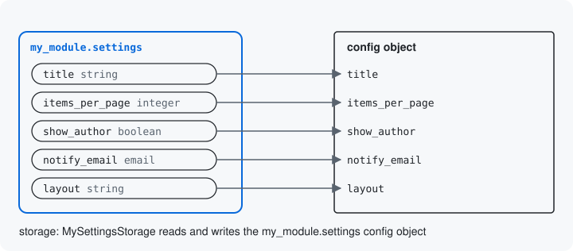

# Storage

Storage is where a resource's values are saved: a config object, a
config entity or a content entity. A resource names one storage class,
and that class reads and writes the values for it. The resource's keys
and rules stay the same whichever storage holds them.



## What a storage class does

The resource says what is accepted. The storage class says where it
goes, in three steps:

- **load** reads what is saved, as the resource's keys, so an edit
  starts from the current values;
- **prepare** turns accepted values into what will be saved and checks
  them, writing nothing, so a request can be tried without saving: a
  tool call that passes `dry_run` stops here
  ([Dry runs](../pipeline.md#dry-runs));
- **commit** writes them.

Your module's settings name their storage class on `#[Resource]`:

```php
#[Resource('my_module.settings', storage: MySettingsStorage::class)]
```

The class extends the module's `ConfigObjectStorage` and names the
config object. This is all of it:

```php
final class MySettingsStorage extends ConfigObjectStorage {

  public const CONFIG = 'my_module.settings';

}
```

`ConfigObjectStorage` does the three steps: it reads
`my_module.settings`, checks the values against the object's config
schema, and saves them, each key under its own name. The config schema
and the install file are written from the resource by a Drush command
([A schema generated from the resource](../storage.md#a-schema-generated-from-the-resource)).
A storage class whose object keeps a key under another name says so in
a `STORED_AT` constant; this one needs none.

## The three kinds

| What Drupal keeps | The storage class | Used by |
| --- | --- | --- |
| A config object | a subclass of `ConfigObjectStorage` | your module's settings |
| A config entity | a subclass of `ConfigEntityStorage` | the placed block (`block`), the content type (`node_type`) |
| A content entity | `ContentEntityStorage`, in the `surface_examples_entity` submodule, used as it is | a node |

A config entity's storage names the entity type and the keys that are
the entity's own properties. The placed block's, `BlockPlacementStorage`
in the `surface_examples_block` submodule, sets `ENTITY_TYPE_ID` to
`block` and `PROPERTIES` to `id`, `status`, `weight`, `theme`, `region`
and `plugin`. The rest of that class turns the
resource's `settings` and `visibility` keys into the arrays core's
block entity keeps; [A config entity](../storage.md#a-config-entity)
explains what a config entity's storage does.

## Why keep them apart

The keys and rules live on the resource, so every place that asks for
the values asks for the same keys, whatever the storage. Moving a value
to another place changes the storage class, not the resource. One
storage class also serves every operation of its resource: the same
`BlockPlacementStorage` saves a new placed block and an edited one,
because the operation tells it which block, through the identity it
knows.

Next: [Resources made of structures](11-resources-made-of-structures.md)

Build it: [A simple config object](../storage.md#a-simple-config-object) and [A config entity](../storage.md#a-config-entity)

See it in the examples: [Examples](../examples/index.md)
