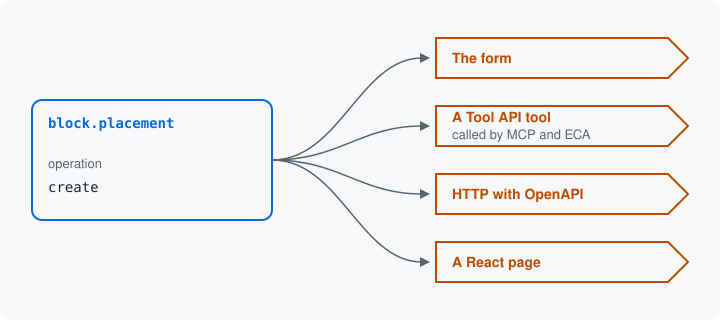

# Doors

A door is a place that asks for an operation's values and hands them to
the module. The module makes every door of an operation from its
resource, so you write no form, tool or endpoint by hand. Each door is
a Drupal mechanism you may already know, and this module or a
submodule turns operations into it.



| Door | What it is in Drupal | Opened by |
| --- | --- | --- |
| The form | A Form API form on a route, built by `SurfaceOperationForm` from the operation. A plugin's settings form is made the same way. | this module |
| A Tool API tool | A plugin of the [Tool](https://www.drupal.org/project/tool) module: a named action with a typed input. One tool per operation, `surface:<resource>:<operation>`. One tool made from an operation can be run by everything that runs Tool API tools: the command line, ECA, FlowDrop, Maestro, MCP servers and AI agents. | this module, with the Tool module installed |
| The command line | `drush tool:run <tool id>`, the Tool module's Drush command, runs a tool from a shell with its input as JSON. | this module, with the Tool module and its Drush command |
| MCP | The Model Context Protocol, which an AI agent outside the site uses to list and call tools. An MCP server module such as MCP Server Tool Bridge (`mcp_server_tool_bridge`) offers the Tool API tools over it. | this module, with the Tool module and an MCP server module |
| ECA | Events, Conditions, Actions: automation a site builder configures. The ECA Tool module (`eca_tool`) makes one ECA action per tool, so an ECA model can run an operation. | this module, with the Tool module and `eca_tool` |
| HTTP with an OpenAPI document | A JSON endpoint per resource at `/surface-api/{resource}`, where the HTTP method picks the operation: `GET` reads, `PATCH` updates, `POST` creates, `DELETE` removes. The OpenAPI 3.1 document lists every operation's paths for any OpenAPI client or code generator. | this module |
| A React page | A React app that draws the form from the JSON Schema the HTTP door serves: an example client of that door. | the `surface_examples_react` example |

The command line, MCP and ECA run the tool, so they ask for the same
values the tool does. The React page reads and writes through the HTTP
door, which this module opens with its OpenAPI document; the page is an
example of a JavaScript client of it. None of these modules is needed
to read this series. To open the tool door and the React page on a
site:

```bash
composer require drupal/tool
drush pm:install tool surface_examples_react
```

## One operation, every door

The placed block, `block.placement` in the `surface_examples_block`
submodule, has a `create` operation. With no code added for any door,
it is served at each of these:

| Door | Where |
| --- | --- |
| The form | `/admin/structure/block/surface/add` |
| A Tool API tool | `surface:block.placement:create` |
| The command line | `drush tool:run surface:block.placement:create --uid=1`, with the input below as `--input` |
| HTTP | `POST /surface-api/block.placement` |
| A React page | `/surface-react/block.placement/create` |

This is the input the tool takes to place a teaser block like the one
on [Structures](03-structures.md):

```json
{
  "values": {
    "label": "Teaser",
    "id": "teaser_front",
    "plugin": "my_teaser",
    "settings": { "headline": "Latest", "limit": 5 },
    "theme": "olivero",
    "region": "content"
  }
}
```

The form draws an element for each of these keys, and the HTTP door's
JSON Schema lists the same keys with the same rules. A `limit` of 60 is
refused at every door with the same message, at `/settings/limit`,
because every door reads the one description the resource gives. A
later page shows [what happens to a value sent in](17-a-value-sent-in.md).

Next: [Other modules](13-other-modules.md)

Build it: [Routes from operations](../resources.md#routes-from-operations) and [Tools](../resources.md#tools)

See it in the examples: [Examples](../examples/index.md)
