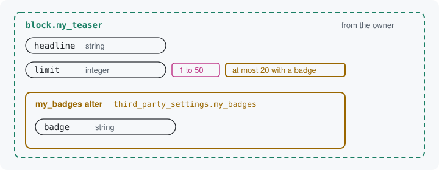

# Other modules

The owner of a resource or structure is the module whose class declares
it. An alter is a class in another module that adds keys to it, or
tightens its rules, without changing the owner's code. An alter may
tighten and never loosen, so every value the owner refuses stays
refused, whichever modules are enabled. Unlike a `hook_*_alter()`,
which may change anything, an alter here may only add keys under its
own module's name and tighten rules.



## Writing an alter

An alter lives in its module's `src/Alter/` directory, where the module
finds it, and names what it alters with `#[Alters]`. Its
`alterInputs()` receives a `BlueprintAdditionsInterface`: the object
the owner's class adds its keys to, limited to what an alter may do. Its
`add()` and `narrow()` are the calls the owner uses.
This alter, in a module named `my_badges`, adds a badge to the teaser
block's settings and caps the number of items while a badge is set:

```php
#[Alters(TeaserBlockStructure::class)]
final class TeaserBadgeAlter implements AltersInputsInterface {

  use StringTranslationTrait;

  public function alterInputs(BlueprintAdditionsInterface $inputs): void {
    $inputs->add('badge', 'string', $this->t('Badge'));
    $inputs->narrow('limit')
      ->when(Condition::present('badge'))
      ->constrain('Range', ['max' => 20]);
  }

}
```

Where each class lives: [Namespaces](../concepts.md#namespaces).

The teaser block and its structure do not change. Every door now offers
the badge, and refuses a `limit` above 20 while a badge is set. The
module saves a key an alter adds under `third_party_settings` and the
alter module's name, here `third_party_settings.my_badges.badge`, so two
modules that each add a `badge` never collide
([Alters](../resources.md#alters) has the details).

## Tighten, never loosen

An alter may lower a maximum, raise a minimum, drop values from a list,
make a key required, or say a key does not apply while another key
holds a value.
It may not remove the owner's keys, change the owner's defaults, or
allow a value the owner's rules refuse. A rule that would loosen is
refused the first time anything asks for the resource, so no form or
tool ever offers the wider value. A maximum of 100 on the teaser's `limit`,
which the owner caps at 50, is refused so:

```
narrow("limit") in the my_badges alter of block.my_teaser widens what
the key declares: the max of the Range constraint moved from 50 to 100.
A declared rule may only narrow; declare the key wider, or the rule
narrower.
```

This is what lets the owner promise something. Code that reads a
`limit` from the teaser block can rely on 1 to 50, whatever alters a
site enables.

Next: [The site and the page](14-site-and-page.md)

Build it: [Alters](../resources.md#alters)

See it in the examples: [Examples](../examples/index.md)
