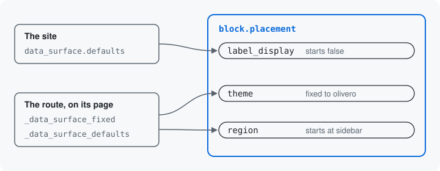

# The site and the page

A key's default comes from the class that declares it, but a site may
want another. A site default is a value the site sets in configuration
for a key, which every door then starts from. A seed is a value one
route sets for the page it serves: it either starts a key from a value
the visitor may change, or fixes the key to a value nobody may change
there.



## The site's defaults

The placed block, `block.placement`, declares `label_display`, "Display
title", with a default of `TRUE`. A site whose blocks rarely show their
title sets its own default in the config object `data_surface.defaults`,
not in code:

```yaml
defaults:
  - resource: block.placement
    key: label_display
    value: 'false'
```

Each entry names the resource, the key and the value. A key inside an
attached structure is named by its path, the keys joined with dots:
`title.value` is the `value` key of a node's title field. The value is
written as text, the way a form posts it, and the module turns it into
the key's type, so `'false'` is the boolean `FALSE`. The form, the tool's input and the
JSON Schema of the create operation now start the key unchecked. A
placed block that already stores a value keeps it: a default is only
what a key with nothing stored starts from.

The site default is checked against the key. A path that names no key,
or a value the key's rules refuse, is refused with a message that names
the key. An alter may not change an owner's default, so this
configuration is the one place a site changes it.

## A page's seeds

A route that serves an operation can seed its keys on its page alone.
This route places blocks in the Olivero theme's sidebar:

```yaml
my_module.place_in_sidebar:
  path: '/admin/structure/block/sidebar/add'
  defaults:
    _form: 'Drupal\data_surface\Form\DataSurfaceOperationForm'
    _title: 'Place a block in the sidebar'
    _data_surface_resource: 'Drupal\data_surface_block\Resource\BlockPlacementResource'
    _data_surface_operation: 'create'
    _data_surface_fixed: { theme: 'olivero' }
    _data_surface_defaults: { region: 'sidebar' }
```

- **`_data_surface_fixed`** fixes `theme`. The form draws it as that
  value, the page's JSON Schema states it as `const`, and any other
  value posted for `theme` is refused, with a message at that key.
- **`_data_surface_defaults`** starts `region` at `sidebar`. The visitor
  may pick another region. Only an operation that creates takes
  defaults. On an update the key starts from the stored value, so the
  module refuses a route that sets defaults for an update operation.

A seed is checked against the key as a site default is, and the
operation's permission still decides who may open the page.

## The order

A key's starting value comes from four places, each laid over the one
before it:

1. the default the owner declares;
2. the site default;
3. values the operation's own code sets ([Operations](07-operations.md));
4. the route's `_data_surface_defaults`.

A fixed value is laid over all of them.

A seed holds on its page alone. The tool, HTTP and every other route
still accept any theme the operation accepts. A value that must hold at
every door belongs in the resource's own rules
([Rules on a key](04-rules-on-a-key.md)), or in an alter's
([Other modules](12-other-modules.md)).

Next: [Access](14-access.md)

Build it: [A site's own defaults](../declaring-a-resource.md#a-sites-own-defaults) and [A route that fixes or fills keys](../forms.md#a-route-that-fixes-or-fills-keys)

See it in the examples: [Examples](../examples/index.md)
