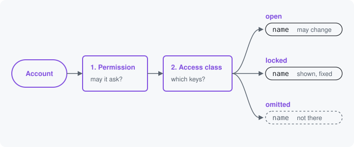

# Access

Access is the answer, for one account, to which keys it may change or
see once the operation's permission lets it ask. A permission says
whether an account may use an operation at all. Access then says, for
that account and that thing, whether the keys are open, locked or left
out.



## Two steps

1. **The operation's permission.** Every operation names one, as an
   earlier page showed. It needs nothing loaded, so every door asks it
   first.
2. **The access class.** A resource names one with `access:` on
   `#[Resource]`. It is asked only after the permission allows, and it
   answers about the thing itself.

The content type resource, `node.type`, uses its access class so it
never allows more than core's own content type form does:

```php
#[Resource('node.type',
  identity: ['type'],
  storage: NodeTypeStorage::class,
  access: NodeTypeAccess::class,
)]
```

```php
final class NodeTypeAccess implements OperationAccessInterface {

  public function __construct(
    protected readonly EntityTypeManagerInterface $entityTypeManager,
  ) {}

  public function access(OperationContext $context, AccountInterface $account): AccessResultInterface {
    if ($context->creates) {
      return $this->entityTypeManager->getAccessControlHandler('node_type')
        ->createAccess(NULL, $account, [], TRUE);
    }
    $id = $context->known['type'] ?? NULL;
    $type = is_string($id) ? $this->entityTypeManager->getStorage('node_type')->load($id) : NULL;
    if (!$type instanceof NodeTypeInterface) {
      // Refused, and cacheable until a content type is created, so the
      // answer stops being no the moment it exists.
      return AccessResult::forbidden(sprintf('There is no "%s" content type to configure.', is_scalar($id) ? (string) $id : ''))
        ->addCacheTags(['config:node_type_list']);
    }
    return $type->access('update', $account, TRUE);
  }

}
```

`$context->creates` is `TRUE` when the operation creates the thing, so
there is no content type to load yet. Otherwise `$context->known['type']`
is the machine name the operation knows; a content type that does not
exist is refused, and one that does answers with core's own update
access.

Both steps must allow. Holding the operation's permission without
core's content type access opens nothing, and the form, the tool, HTTP
and the React page all read the same answer.

## Three answers

An access class returns core's `AccessResultInterface`, as above, or an
`AccessAnswer` with one of three answers:

| Answer | Made with | What every door does with the keys |
| --- | --- | --- |
| Open | `AccessAnswer::open()`, or core's allowed | They may be changed. |
| Locked | `AccessAnswer::locked($reason)` | They are shown and fixed: the form disables them, the JSON Schema marks them `readOnly: true`, and a value sent for them changes nothing. |
| Omitted | `AccessAnswer::omitted($reason)`, or core's forbidden on a structure | They are not there: no form element, no schema property, no tool input. |

A resource's access class answers for all of its keys: omitted there
means the account is denied the operation, at every door. A structure
may name an access class too, with `access:` on `#[Structure]`, and
its answer covers only the key the structure is attached at: omitted
there leaves out that one key, and the rest of the form stays. So one
part of a form can be locked or left out for an account while the rest
stays open.

## Known ahead, or at the request

An answer that depends only on the account's permissions or roles is
known ahead and stated in the JSON Schema; one that reads stored data
waits for the request
([Static and runtime access](../resources.md#static-and-runtime-access)).

Access only says whether keys may be changed, seen, or neither. An
account that may choose from fewer values is a refiner's job, which
narrows the key's rules for that account.

Next: [Sealed](16-sealed.md)

Build it: [Access](../resources.md#access) and [Static and runtime access](../resources.md#static-and-runtime-access)

See it in the examples: [Examples](../examples/index.md)
