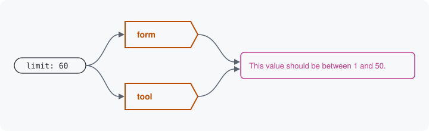

# A value sent in

Every door hands the values it receives to the same service, [the
pipeline](../pipeline.md). It runs the same steps whatever door the
values came from: it turns each value into its key's type, checks it
against the sealed data surface, and then refuses it or saves it
through the storage. The steps are the same and the data surface is the
same, so one wrong value gets one message at every door.



## The steps

1. **Access.** The operation's permission and the resource's access
   answer for the account. A refusal stops here.
2. **Accept.** The values sent are laid over what storage holds and the
   defaults, and each one is turned into its key's type: the text `"5"`
   from a form becomes the integer `5`. A key the data surface does not
   have is refused, not dropped. A locked key keeps what storage holds.
3. **Validate.** The refiners narrow the data surface for these values,
   then every rule runs. Each refusal is filed at its key's path, in the
   rule's own words.
4. **Prepare.** The storage lays the values out the way it saves them
   and checks them, writing nothing. A dry run stops here.
5. **Commit.** The storage writes. This is the only step that changes
   the site.

The door then answers with the result: which values were taken, which
were refused and why, and whether anything was written.

## One value, one answer

Take the teaser block's settings: `limit` is an integer with the rule
Range, 1 to 50. Code with no door at all calls the same service:

```php
// $block is the teaser block plugin.
$result = \Drupal::service('data_surface.pipeline')->submit(
  $block->getDataSurface(),
  ['headline' => 'Latest', 'limit' => '60'],
  new PluginConfigurationStorage($block),
);
$result->isValid();   // FALSE: nothing was written.
```

Where each class lives: [Namespaces](../concepts.md#namespaces).

A placed block's form, asked for 60 items, prints the rule's message in
the messages at the top of the page, after the field's label:

```
Number of items: This value should be between 1 and 50.
```

The tool that places the block answers the same value with the same
message, at the key's path under the placed block's `settings`. The
object inside is the one [Rules on a key](04-rules-on-a-key.md) showed,
in the tool's `violations` envelope (an excerpt of its answer):

```json
"violations": [
  {
    "path": "/settings/limit",
    "code": "not_in_range",
    "message": "This value should be between 1 and 50."
  }
]
```

HTTP refuses it with status 422 and the same object in its `errors`.
No door wrote this message. The Range rule on the sealed data surface
did, once, and the one service carried it to whichever door asked.

Next: [Where next](17-where-next.md)

Build it: [The stages](../pipeline.md#the-stages)

See it in the examples: [Examples](../examples/index.md)
