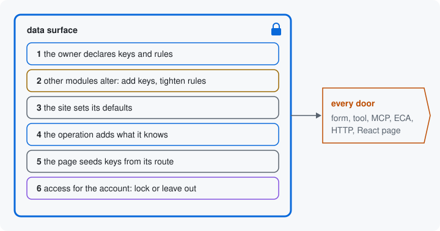

# Sealed

A data surface is what one resource accepts for one operation, on this
site, for this account: its keys and their rules. The build is the step
that makes it: it asks each party with a say, in a fixed order, and
collects their answers. When the last party has answered, the build
seals the data surface: no key can be added and no rule loosened after
that. Every door reads that one sealed data surface.



## Who has a say, in order

1. **The owner declares** its keys, their rules and its refiners,
   without knowing the door, the site or the account.
2. **Other modules alter.** The build refuses an alter that loosens a
   rule.
3. **The site sets defaults.** A default the key's rules refuse stops
   the build, with a message that names the key.
4. **The operation adds what it knows**: the identity keys it knows,
   locked (on a content type's update, `type` is fixed), and values its
   own code sets.
5. **The page seeds** keys from its route: its defaults, then its fixed
   values.
6. **Access answers for the account**, locking keys or leaving them
   out.

Then the build seals the result. Steps 1, 3, 4 and 5 give a key its
starting value in the order [The site and the page](14-site-and-page.md)
showed.
Each party works on what the earlier ones left, so a later one can
tighten further but never undo an earlier tightening.

After the seal, the data surface's definitions are an object that
refuses writes, and no method adds a key or loosens a rule. It can only
be read:

```php
$resources = \Drupal::service('data_surface.resources');
$context = $resources->operation(NodeTypeResource::class, 'update', ['type' => 'article']);
$surface = $resources->build(NodeTypeResource::class, $context);

$surface->isLocked('type');   // TRUE: the operation knows which one.
```

## Access, twice

Access has a say in the build, and the pipeline that handles values
sent in asks it again. At the build, its answer decides which keys are
locked or left out of the sealed data surface, so every door draws the
same keys. When values arrive, the pipeline asks it again for the thing
the values are about, since only then is that thing loaded
([A value sent in](17-a-value-sent-in.md)).

## Why the doors agree

Rules between keys whose answers are known from the values alone are
written into the sealed data surface ahead of time, as
[Rules between keys](07-rules-between-keys.md) showed. When values
arrive, the pipeline applies those same answers to the values sent, and
runs the runtime refiners then. The module checks that each answer is
narrower than what the key already allowed. So nothing after the seal
adds a key or allows a value the sealed data surface did not allow.

The doors keep no rules of their own. The form draws its elements from
the sealed data surface, the tool its input schema, HTTP its JSON
Schema. When a module tightens a rule with an alter, the next build
carries the tighter rule to every door at once. And because nothing
widens after the seal, what a door told a caller, such as a maximum or
a list of choices, is still true when the values come back.

Next: [A value sent in](17-a-value-sent-in.md)

Build it: [The build step](../how-it-fits.md#the-build-step)

See it in the examples: [Examples](../examples/index.md)
