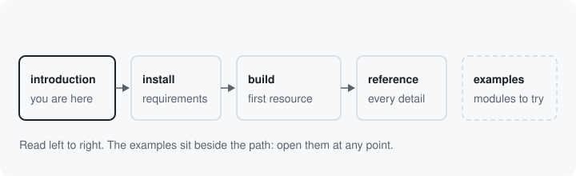

# Where next

You can now name each idea in this module and say what it is for. The
documentation has four sections beside this one, each for a different
question: how to install it, how to build with it, how a detail works,
and what a working module looks like.

## Install it

[Installation](../installation.md) lists the requirements, the Composer
and Drush commands, and the optional submodules. The form needs only
the base module. The tool needs the `tool` module, HTTP and the React
page need `surface_react`, and the OpenAPI document needs
`surface_openapi`.

## Build your first resource

[Your first resource](../first-resource.md) builds a settings page from
four things: a resource class, an operation on it, a storage class for
its config object, and its keys. It ends with the form and the tool
running on your site. [Your second resource](../second-resource.md)
then adds one key whose allowed values depend on another key, written
as one refiner.

## Look things up

[The reference](../index.md) covers every idea in full: each attribute
and method, every way to put resources together, the generated forms,
the documents HTTP serves, and the reasons behind each rule. Read it
when a build page links you there or when you need one detail.

## Try the examples

[The examples](../examples/index.md) list the shipped example modules:
what each one shows, the command that installs it, and the page on the
site where you can try it. Nothing in this series or the build pages
depends on them.

## The words

[The glossary](../glossary.md) gives each word this series defined in
one sentence, with a link back to the page that introduces it.

Next: back to [the introduction](index.md)

Build it: [Your first resource](../first-resource.md)

See it in the examples: [Examples](../examples/index.md)
